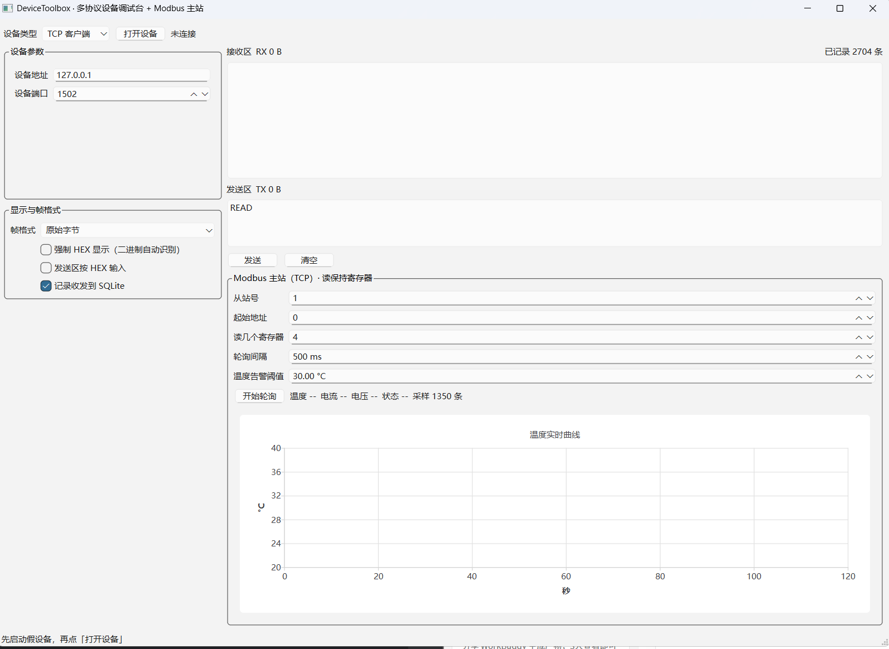
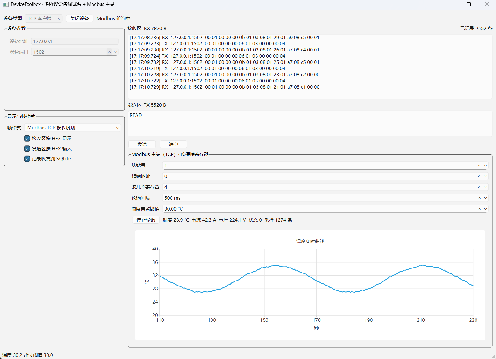
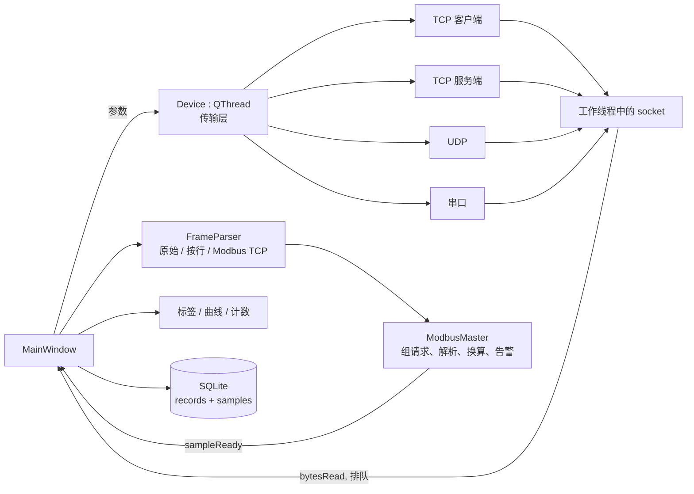

# DeviceToolbox

基于 Qt 6 的桌面工具，用于串口/网络设备调试与 Modbus TCP 主站轮询。



## 功能

- 四种通信方式：TCP 客户端、TCP 服务端、UDP、串口
- 原始字节收发，HEX / 文本显示切换、HEX 输入，带时间戳、来源标记、收发字节计数
- 三种切帧模式：原始字节、按换行切、按 Modbus TCP 的 MBAP 长度字段切（支持半包与粘包）
- Modbus TCP 主站：周期读取保持寄存器、功能码 03、异常应答检测、大端解析寄存器、按倍率换算工程值
- 阈值告警：温度超过设定值时数字变红，并在接收区追加一行 `[ALARM]`
- Qt Charts 实时曲线，120 秒滑动窗口
- SQLite 落库：原始帧存 `records`，解析后的采样值存 `samples`
- 三层架构：传输层 / 帧解析层 / 协议语义层，除 Qt 外无第三方依赖

## 环境要求

- Qt 6.8 及以上，需包含模块：Core、Gui、Widgets、Network、SerialPort、Sql、Charts
- CMake 3.20+
- 支持 C++17 的编译器
- Linux 下另需 SQLite 的 Qt 驱动插件（`libqt6sql6-sqlite`）与 OpenGL 开发头文件

## 构建

Windows（cmd）：

```cmd
set PATH=D:\Qt\Tools\CMake_64\bin;D:\Qt\Tools\Ninja;D:\Qt\Tools\mingw1310_64\bin;%PATH%
cmake -B build -G Ninja -DCMAKE_BUILD_TYPE=Release -DCMAKE_PREFIX_PATH=D:/Qt/6.8.3/mingw_64
cmake --build build
```

Windows（Git Bash）：

```bash
export PATH="/d/Qt/Tools/CMake_64/bin:/d/Qt/Tools/Ninja:/d/Qt/Tools/mingw1310_64/bin:$PATH"
cmake -B build -G Ninja -DCMAKE_BUILD_TYPE=Release
cmake --build build
```

Linux / WSL2：

```bash
sudo apt install build-essential cmake ninja-build qt6-base-dev libqt6serialport6-dev libqt6sql6-sqlite libqt6charts6-dev libgl-dev
cmake -B build -G Ninja -DCMAKE_BUILD_TYPE=Release
cmake --build build -j$(nproc)
```

Windows 下构建完成后会自动调用 `windeployqt` 部署运行库；Linux 下跳过。

## 快速开始

仓库自带一个模拟设备，同时扮演 TCP 服务端和 UDP 端点，无需硬件即可测试。

终端 1：

```bash
python tools/fake_device.py
```

终端 2 —— 启动 `build/DeviceToolbox.exe`（Linux 下为 `./build/DeviceToolbox`），然后：

1. 设备类型选 **TCP 客户端**，地址 `127.0.0.1`、端口 `1502`，点 **打开设备**
2. 右下 Modbus 主站面板保持默认：从站号 `1`、起始地址 `0`、寄存器数 `4`、轮询间隔 `500 ms`、温度阈值 `30 °C`
3. 点 **开始轮询**




`records.db` 生成在**进程的工作目录**，不是 exe 所在目录。

## 架构


**传输层** —— `Device` 管理线程生命周期与统一信号接口，四个子类实现 `initDevice()`、`writeActually()`、`deinitDevice()`。网络对象在 `run()` 内创建，使它们的信号归属于工作线程。发送统一走 `writeBytes()` → `invokeWriteBytes` → `writeActually()`。

**帧解析层** —— `FrameParser` 把字节流切成帧，支持原样透传、按换行切、按 Modbus TCP 的 MBAP 长度字段切（`total = 6 + length`）。半帧留在缓存里等下一批，一次收到多帧会切成列表返回；缓存超过 4096 字节则整块吐出，防止对方一直不发分隔符时无限增长。

**协议层** —— `ModbusMaster` 拼 12 字节读请求，校验应答（长度、功能码、异常标志、字节数），大端解析四个寄存器、然后发出 `sampleReady` 或 `alarm`。。


## Modbus TCP 帧格式

读请求（12 字节）：

```text
00 01 | 00 00 | 00 06 |  01  |  03  | 00 00 | 00 04
事务ID  协议ID   长度   从站  功能码  起始地址 读几个
```

应答（17 字节）：

```text
00 01 00 00 00 0B 01 03 08 | 01 4F 01 D0 08 98 00 01
                    长度=11   温度  电流  电压  状态
```

寄存器按大端解析并除以 10，这是模拟设备约定的倍率。真实设备可能用别的倍率，改 `parseResponse()` 即可。

## 数据库

| 表 | 内容 | 由谁写入 |
|---|---|---|
| `records` | 每帧收发的原始字节 | `storeFrame()` |
| `samples` | 每次成功解析的 Modbus 采样值 | `onSample()` |

## 目录结构

```text
src/
  main.cpp                 程序入口
  mainwindow.h/.cpp        界面、轮询定时器、显示、曲线、落库分发
  device.h/.cpp            QThread 基类：生命周期、参数、信号
  devices.h/.cpp           TCP 客户端/服务端、UDP、串口子类 + 工厂
  devicepanel.h/.cpp       分页参数表单、QVariantMap 打包
  frameparser.h/.cpp       原始 / 按行 / Modbus TCP 切帧
  modbusmaster.h/.cpp      Modbus 请求拼装、应答解析、告警
  storage.h/.cpp           SQLite 建表与插入
tools/
  fake_device.py           TCP/UDP 模拟设备
docs/                      截图
```

## 验证

在 Qt 6.8.3 / MinGW 13.1.0 / Ninja 下构建，并用模拟设备做了端到端测试：

- 5100 字节、内含 300 个粘连的 Modbus 帧，切成 300 个 17 字节的帧
- 连续轮询 6 秒得到 19 次采样、0 次解析错误，写入 `samples` 且时间戳连续
- 温度超过 30 °C 触发告警，回落后停止
- TCP 客户端、TCP 服务端广播、UDP 三种方式都收到回显，来源标记正确
- Linux 下已验证编译

## 后续计划

- 串口上的 Modbus RTU（带 CRC 校验）
- 断线自动重连
- 多设备并发轮询
- 数据导出与配置持久化
