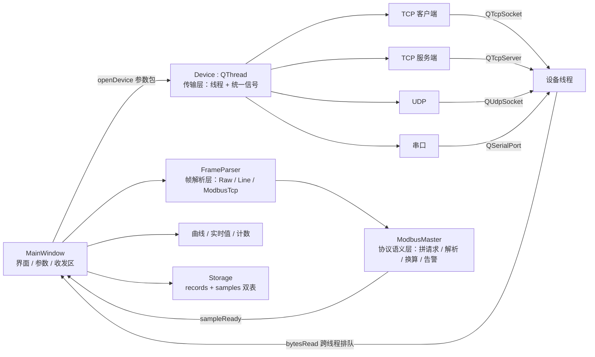

# DeviceToolbox · 多协议设备调试台 + Modbus 主站

一个完整的 Qt 上位机工程：四种通信方式任选 → 连设备 → 原始帧收发与显示 → Modbus TCP 定时轮询读寄存器 → 工程值/曲线/告警 → SQLite 双表落库。

界面布局参照 x-tools，但不是复刻：内核是「传输层 → 帧解析层 → 协议语义层」三层，零第三方依赖。既能当通用调试台看原始字节，也能当 Modbus 主站采集真实数据，两条链共用同一套设备层。

## 一、保留与砍掉

| 保留 | 砍掉 |
|---|---|
| TCP 客户端 / TCP 服务端 / UDP / 串口 | Lua、JavaScript 脚本扩展、插件系统 |
| 原始字节 / 按行 / Modbus TCP 按长度切帧 | BLE、CAN、MQTT、CoAP、HID、WebSocket、HTTP、SCTP |
| **Modbus TCP 主站：定时轮询读保持寄存器、功能码解析、工程值换算、阈值告警** | Modbus RTU / CRC（没有真串口硬件，写了没法实测） |
| **Qt Charts 温度实时曲线 + 120 秒滑动窗口** | 条码/二维码、文件传输、多语言、主题 |
| 收发区 HEX↔文本、时间戳、来源标记、字节统计 | 自动重连、配置持久化 |
| SQLite 双表：`records` 原始帧 + `samples` 工程值 | 任何需要第三方库的构建 |

## 二、快速开始

### 1. 先起假设备（必须，窗口别关）

```bash
python tools/fake_device.py
```

它同时起三件事：TCP 服务端 `127.0.0.1:1502`、UDP 同端口、以及反复尝试反向连 `127.0.0.1:1503`。收到 Modbus 读寄存器请求回 17 字节应答帧（4 个寄存器：温度×10、电流×10、电压×10、状态），温度在 28.5 与 33.5 之间周期变化，方便演示阈值告警；收到普通文本回一行文本。

### 2. 构建

Windows（cmd）：

```cmd
set PATH=D:\Qt\Tools\CMake_64\bin;D:\Qt\Tools\Ninja;D:\Qt\Tools\mingw1310_64\bin;%PATH%
cmake -B build -G Ninja -DCMAKE_BUILD_TYPE=Release -DCMAKE_PREFIX_PATH=D:/Qt/6.8.3/mingw_64
cmake --build build
```

Windows（Git Bash）：

```bash
export PATH="/d/Qt/Tools/CMake_64/bin:/d/Qt/Tools/Ninja:/d/Qt/Tools/mingw1310_64/bin:$PATH"
cmake -B build -G Ninja -DCMAKE_BUILD_TYPE=Release
cmake --build build
```

WSL2 / Linux（构建验证用；界面需 WSLg 和中文字体）：

```bash
sudo apt install build-essential cmake ninja-build qt6-base-dev libqt6serialport6-dev libqt6sql6-sqlite libqt6charts6-dev libgl-dev
cmake -B build -G Ninja -DCMAKE_BUILD_TYPE=Release
cmake --build build -j$(nproc)
```

`CMakeLists.txt` 里 Windows 的 Qt 路径包在 `if (WIN32 AND NOT DEFINED CMAKE_PREFIX_PATH)` 里，Linux 不会去读 `D:/Qt/...`。Windows 每次构建自动跑 `windeployqt` 补齐运行库、Charts 和 `sqldrivers/qsqlite.dll`。

### 3. 运行 Modbus 主站（简历演示这条）

1. 起假设备；
2. 双击 `build/DeviceToolbox.exe`，设备类型选 **TCP 客户端**，地址 `127.0.0.1`、端口 `1502`，点「打开设备」；
3. 右下「Modbus 主站」面板：从站号 1、起始地址 0、读 4 个寄存器、间隔 500ms、温度阈值 30°C；
4. 点「开始轮询」。温度/电流/电压/状态四个值开始跳，温度超过 30 时温度值变红且输出区出现 `[ALARM]`，曲线持续更新；
5. 数据表 `samples` 里开始落采样值。

调试台模式就选别的协议、换帧格式，照常收发原始字节。

`records.db` 生成在**程序的工作目录**（不是 exe 同目录），CLion 里通常是 `cmake-build-debug/`。

## 三、架构：三层切分



**三层各管一件事**：

- **传输层**（`Device` + 四子类）：怎么连、怎么发、怎么收。**不知道「帧」是什么**。
- **帧解析层**（`FrameParser`）：把一把字节切成一帧一帧。**不知道帧里是什么协议**。
- **协议语义层**（`ModbusMaster`）：拼 12 字节读请求、解析功能码 03、按大端抠出 4 个寄存器、除以 10 换成工程值、判断温度阈值。**不碰 socket、不碰 UI**。

**好处**：换切帧方式不动设备代码；换协议不动界面；Modbus 逻辑能单独拿去测。加第五种协议只改枚举、子类、参数页、工厂四处。

**线程模型**：`Device` 对象属于 UI 线程，只有 `run()` 大括号里跑在设备线程。socket 在设备线程 `new`，`readyRead` 才归它管。发数据走 `writeBytes() → emit invokeWriteBytes → 排队 → writeActually()`；收数据走 `readyRead → emit bytesRead → 排队 → onBytesRead()`。Modbus 解析、曲线、落库全在 UI 线程——500ms 一次，实测占用可忽略。

## 四、Modbus 主站细节

**请求帧**（12 字节）：

```text
00 01 | 00 00 | 00 06 | 01 | 03 | 00 00 | 00 04
事务ID  协议ID  长度   从站 功能码 起始地址  读4个
```

**应答帧**（17 字节）：

```text
00 01 00 00 00 0B 01 03 08 | 01 11 01 D0 08 98 00 01
                  ↑长度11    ↑温度285 电流464 电压2200 状态1（÷10 得 28.5/46.4/220.0）
```

`ModbusMaster::parseResponse()` 依次检查：应答太短 / 功能码最高位（异常应答）/ 协议 ID / 长度字段 / 功能码是否 03 / 数据区字节数，全过了才抠寄存器值。`onFrame()` 是统一入口：成功 `emit sampleReady`，失败 `emit protocolError`，超阈值额外 `emit alarm`。

**按长度字段切帧**由 `FrameParser::ModbusTcp` 完成：`整帧长度 = 6 + 长度字段`，半包留着等、粘包切两帧。

## 五、落库：两张表

| 表 | 存什么 | 谁写 |
|---|---|---|
| `records` | 原始收发帧：`ts / direction / protocol / peer / size / payload_hex` | `MainWindow::storeFrame()`，每次收发 |
| `samples` | 解析后的工程值：`ts / temp / current_ma / voltage / status` | `MainWindow::onSample()`，每次 Modbus 采样 |

两张表都由 `Storage::open()` 建，用 `IF NOT EXISTS` 保证重启不报错；插入用 `prepare + addBindValue`，不拼字符串。

**为什么留在 UI 线程**：`QSqlDatabase` 只能在创建它的线程里用；连接由窗口创建，写入就必须在窗口线程。x-tools 没有 SQL，它用 `SaveThread` + 加锁队列写文本文件，因为通用调试器一秒可能几千帧。本项目 500ms 一次，不需要那套。

## 六、文件职责

| 文件 | 一句话 |
|---|---|
| `src/device.h/.cpp` | `Device : QThread` 基类：开关线程、参数包、统一信号、写请求排队 |
| `src/devices.h/.cpp` | TCP 客户端/服务端、UDP、串口四个子类 + `createDevice()` 工厂 |
| `src/devicepanel.h/.cpp` | `QStackedWidget` 参数面板，`save()` 打包 `QVariantMap` |
| `src/frameparser.h/.cpp` | 帧解析层：Raw / Line / Modbus TCP 按长度切 |
| `src/modbusmaster.h/.cpp` | **协议语义层：拼读请求、解析应答、换算工程值、阈值告警** |
| `src/storage.h/.cpp` | SQLite 双表：原始帧记录 + Modbus 采样值 |
| `src/mainwindow.h/.cpp` | 界面、协议切换、轮询定时器、收发显示、曲线、把数据分发给各消费者 |
| `tools/fake_device.py` | 测试用假设备，不进产品代码 |

## 七、验收（实测）

Qt 6.8.3 / MinGW 13.1.0 / Ninja，本机编译 + 起假设备实跑：

| 项目 | 结果 |
|---|---|
| 编译 | 11/11 通过，退出码 0；`windeployqt` 部署 Charts、SQLite 驱动等全套 DLL |
| Modbus 主站全链路 | 发 12 字节请求 → 收 17 字节应答 → 解析出 28.5/46.4/220.0/1，6 秒 19 次采样、0 解析错误 |
| 阈值告警 | 温度 33.5 > 30 时发 4 次告警，文字 `温度 33.5 超过阈值 30.0`；降到 28.5 后停止 |
| SQLite 双表 | `records` 和 `samples` 均建表成功；`samples` 19 行，时间戳连续，四个字段齐全 |
| 四协议收发 | TCP 客户端（按行 / Modbus）、UDP、TCP 服务端广播均收到回显，来源标记正确 |
| GUI 启动 | 限时 3 秒未崩溃，窗口和两张表正常，无残留进程 |
| 异常帧 | 功能码 83、长度对不上、数据区过短都会被 `parseResponse()` 拦下（单元测试覆盖） |

串口链路要真硬件、Linux 端到端运行两项未做。

## 八、和 x-tools 的差异（面试讲这段）

> x-tools 是通用协议调试器，带 19 个第三方库、Lua/JS 脚本、插件和图表，配置阶段下载半小时；它的落盘用 `SaveThread` 写文本文件，没有 SQL。我的项目按「传输层 / 帧解析层 / 协议语义层」三层拆开：同一条 TCP 连接能切 Raw / 按行 / Modbus TCP 三种切法而设备层不改；在此之上做了 Modbus TCP 主站，定时轮询读保持寄存器，解析功能码和寄存器值，换算工程值后显示曲线、判阈值告警，原始帧和采样值分别落进 SQLite 两张表。加一种协议只改枚举、子类、参数页、工厂四处，界面主逻辑不动。

## 九、简历可用描述

> **多协议设备调试台 + Modbus 主站**（Qt 6 / C++17 / CMake）
> 基于 `QThread` + 信号槽实现 TCP 客户端/服务端、UDP、串口四种通信方式，采集线程与 UI 解耦；设计 `Device` 基类与工厂，参数经 `QVariantMap` 传递，界面层不依赖具体协议。按「传输层 / 帧解析层 / 协议语义层」三层解耦：独立帧解析支持原始字节、按行、Modbus TCP 按 MBAP 长度字段切帧，处理半包与粘包；`ModbusMaster` 实现 03 功能码请求构造、异常帧识别、大端寄存器解析与工程值换算，500ms 定时轮询配合 Qt Charts 实时曲线与温度阈值告警。SQLite 双表分别落原始帧与采样值；配套 Python 假设备完成四协议与 Modbus 全链路端到端验证，实测 19 次采样 0 解析错误。

## 十、第二版再做

Modbus RTU + CRC（需要真串口）、多设备并发、自动重连、导出脚本、配置持久化、Linux 端到端运行。
